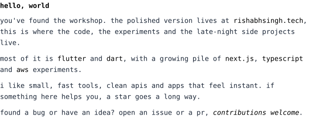
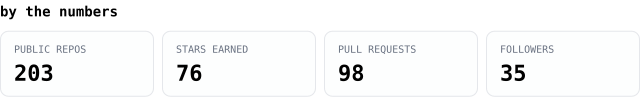
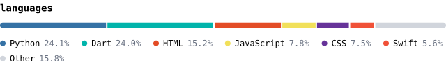
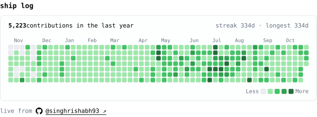
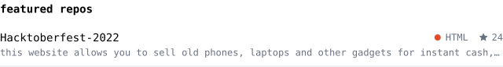
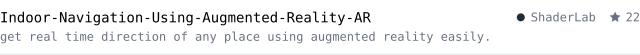
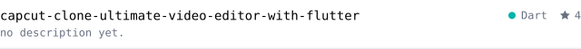
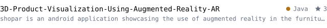

<!-- Generated by .readme/build.py. Edit .readme/content.json, not this file. -->

<picture><source media="(prefers-color-scheme: dark)" srcset="./assets/dark/hero.svg"></picture>

<picture><source media="(prefers-color-scheme: dark)" srcset="./assets/dark/intro.svg"></picture>

<a href="https://github.com/singhrishabh93?tab=repositories"><picture><source media="(prefers-color-scheme: dark)" srcset="./assets/dark/stats.svg"></picture></a>

<picture><source media="(prefers-color-scheme: dark)" srcset="./assets/dark/languages.svg"></picture>

<a href="https://github.com/singhrishabh93"><picture><source media="(prefers-color-scheme: dark)" srcset="./assets/dark/ship-log.svg"></picture></a>

<a href="https://github.com/singhrishabh93/Hacktoberfest-2022"><picture><source media="(prefers-color-scheme: dark)" srcset="./assets/dark/repo-0.svg"></picture></a> 
<a href="https://github.com/singhrishabh93/Indoor-Navigation-Using-Augmented-Reality-AR"><picture><source media="(prefers-color-scheme: dark)" srcset="./assets/dark/repo-1.svg"></picture></a> 
<a href="https://github.com/singhrishabh93/Flutter-Basics-Guide"><picture><source media="(prefers-color-scheme: dark)" srcset="./assets/dark/repo-2.svg"></picture></a> 
<a href="https://github.com/singhrishabh93/capcut-clone-ultimate-video-editor-with-flutter"><picture><source media="(prefers-color-scheme: dark)" srcset="./assets/dark/repo-3.svg"></picture></a> 
<a href="https://github.com/singhrishabh93/3D-Product-Visualization-Using-Augmented-Reality-AR"><picture><source media="(prefers-color-scheme: dark)" srcset="./assets/dark/repo-4.svg"></picture></a>

<a href="https://github.com/singhrishabh93/standup"><picture><source media="(prefers-color-scheme: dark)" srcset="./assets/dark/active-0.svg"></picture></a> 
<a href="https://github.com/singhrishabh93/murmur"><picture><source media="(prefers-color-scheme: dark)" srcset="./assets/dark/active-1.svg"></picture></a> 
<a href="https://github.com/singhrishabh93/streaks"><picture><source media="(prefers-color-scheme: dark)" srcset="./assets/dark/active-2.svg"></picture></a> 
<a href="https://github.com/singhrishabh93/m3-theme"><picture><source media="(prefers-color-scheme: dark)" srcset="./assets/dark/active-3.svg"></picture></a> 
<a href="https://github.com/singhrishabh93/store-listing"><picture><source media="(prefers-color-scheme: dark)" srcset="./assets/dark/active-4.svg"></picture></a>

<a href="https://www.rishabhsingh.tech"><picture><source media="(prefers-color-scheme: dark)" srcset="./assets/dark/portfolio.svg"></picture></a>

<picture><source media="(prefers-color-scheme: dark)" srcset="./assets/dark/links.svg"></picture>

<a href="https://x.com/singhrishabh93"><picture><source media="(prefers-color-scheme: dark)" srcset="./assets/dark/link-x.svg"></picture></a>&nbsp;&nbsp;
<a href="https://linkedin.com/in/singhrishabh1670"><picture><source media="(prefers-color-scheme: dark)" srcset="./assets/dark/link-linkedin.svg"></picture></a>&nbsp;&nbsp;
<a href="mailto:singhrishabh1670@gmail.com"><picture><source media="(prefers-color-scheme: dark)" srcset="./assets/dark/link-email.svg"></picture></a>&nbsp;&nbsp;
<a href="https://instagram.com/singhrishabh1670"><picture><source media="(prefers-color-scheme: dark)" srcset="./assets/dark/link-instagram.svg"></picture></a>&nbsp;&nbsp;
<a href="https://drive.google.com/drive/folders/1muWHUOZfFuaGLx90vatZFDDIkkljI25z"><picture><source media="(prefers-color-scheme: dark)" srcset="./assets/dark/link-resume.svg"></picture></a>

<picture><source media="(prefers-color-scheme: dark)" srcset="./assets/dark/footer.svg"></picture>

