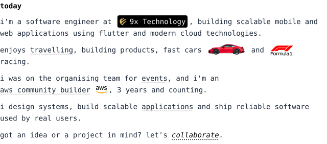
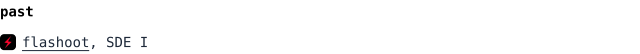
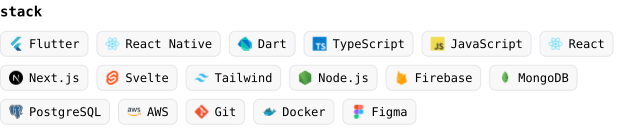
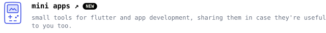
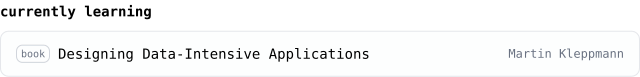
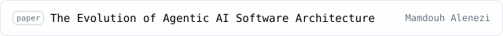
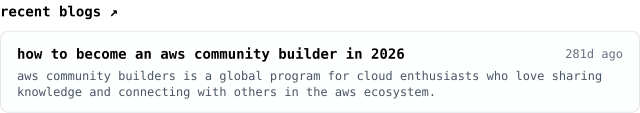
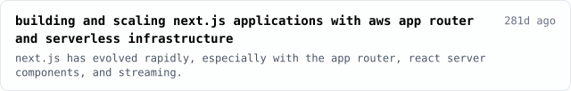

<!-- Generated by .readme/build.py. Edit .readme/content.json (and TODAY in build.py for the intro), not this file. -->

<a href="https://www.rishabhsingh.tech"><picture><source media="(prefers-color-scheme: dark)" srcset="./assets/dark/hero.svg"></picture></a>

<a href="https://www.rishabhsingh.tech"><picture><source media="(prefers-color-scheme: dark)" srcset="./assets/dark/today.svg"></picture></a>

<a href="https://flashoot.com/"><picture><source media="(prefers-color-scheme: dark)" srcset="./assets/dark/past-0.svg"></picture></a> 
<a href="https://monova.in"><picture><source media="(prefers-color-scheme: dark)" srcset="./assets/dark/past-1.svg"></picture></a> 
<a href="https://picapool.com/"><picture><source media="(prefers-color-scheme: dark)" srcset="./assets/dark/past-2.svg"></picture></a> 
<a href="https://www.profitlyx.com/"><picture><source media="(prefers-color-scheme: dark)" srcset="./assets/dark/past-3.svg"></picture></a>

<picture><source media="(prefers-color-scheme: dark)" srcset="./assets/dark/stack.svg"></picture>

<a href="https://github.com/singhrishabh93"><picture><source media="(prefers-color-scheme: dark)" srcset="./assets/dark/ship-log.svg"></picture></a>

<a href="https://play.google.com/store/apps/details?id=com.aspirantos.app"><picture><source media="(prefers-color-scheme: dark)" srcset="./assets/dark/project-0.svg"></picture></a> 
<a href="https://play.google.com/store/apps/details?id=com.eli5.app"><picture><source media="(prefers-color-scheme: dark)" srcset="./assets/dark/project-1.svg"></picture></a> 
<a href="https://splitto-zeta.vercel.app/"><picture><source media="(prefers-color-scheme: dark)" srcset="./assets/dark/project-2.svg"></picture></a> 
<a href="https://share-17ddf.web.app/"><picture><source media="(prefers-color-scheme: dark)" srcset="./assets/dark/project-3.svg"></picture></a> 
<a href="https://play.google.com/store/apps/details?id=com.beyou.affirmation"><picture><source media="(prefers-color-scheme: dark)" srcset="./assets/dark/project-4.svg"></picture></a> 
<a href="https://mplads.vercel.app/"><picture><source media="(prefers-color-scheme: dark)" srcset="./assets/dark/project-5.svg"></picture></a> 
<a href="https://github.com/SafeConnect-App/safe-connect-app"><picture><source media="(prefers-color-scheme: dark)" srcset="./assets/dark/project-6.svg"></picture></a>

<a href="https://www.rishabhsingh.tech/mini-apps"><picture><source media="(prefers-color-scheme: dark)" srcset="./assets/dark/mini-apps.svg"></picture></a>

<a href="https://0-lucas.github.io/digital-garden/99.-Books/Martin-Kleppmann---Designing-Data-Intensive-Applications_-O%E2%80%99Reilly-Media-(2017).pdf"><picture><source media="(prefers-color-scheme: dark)" srcset="./assets/dark/reading-0.svg"></picture></a> 
<a href="https://github.com/aasthas2022/SDE-Interview-and-Prep-Roadmap/blob/main/System%20Design/Resources/System%20Design%20Interview%20by%20Alex%20Xu.pdf"><picture><source media="(prefers-color-scheme: dark)" srcset="./assets/dark/reading-1.svg"></picture></a> 
<a href="https://arxiv.org/pdf/2602.10479"><picture><source media="(prefers-color-scheme: dark)" srcset="./assets/dark/reading-2.svg"></picture></a>

<a href="https://www.rishabhsingh.tech/blog/how-to-become-an-aws-community-builder-in-2026"><picture><source media="(prefers-color-scheme: dark)" srcset="./assets/dark/blog-0.svg"></picture></a> 
<a href="https://www.rishabhsingh.tech/blog/building-and-scaling-next-js-applications-with-aws-app-router-and-serverless-infrastructure"><picture><source media="(prefers-color-scheme: dark)" srcset="./assets/dark/blog-1.svg"></picture></a>

<a href="https://www.rishabhsingh.tech/products"><picture><source media="(prefers-color-scheme: dark)" srcset="./assets/dark/shipped-products.svg"></picture></a>

<picture><source media="(prefers-color-scheme: dark)" srcset="./assets/dark/links.svg"></picture>

<a href="https://github.com/singhrishabh93"><picture><source media="(prefers-color-scheme: dark)" srcset="./assets/dark/link-github.svg"></picture></a>&nbsp;&nbsp;
<a href="https://x.com/singhrishabh93"><picture><source media="(prefers-color-scheme: dark)" srcset="./assets/dark/link-x.svg"></picture></a>&nbsp;&nbsp;
<a href="https://linkedin.com/in/singhrishabh1670"><picture><source media="(prefers-color-scheme: dark)" srcset="./assets/dark/link-linkedin.svg"></picture></a>&nbsp;&nbsp;
<a href="mailto:singhrishabh1670@gmail.com"><picture><source media="(prefers-color-scheme: dark)" srcset="./assets/dark/link-email.svg"></picture></a>&nbsp;&nbsp;
<a href="https://instagram.com/singhrishabh1670"><picture><source media="(prefers-color-scheme: dark)" srcset="./assets/dark/link-instagram.svg"></picture></a>&nbsp;&nbsp;
<a href="https://drive.google.com/drive/folders/1muWHUOZfFuaGLx90vatZFDDIkkljI25z"><picture><source media="(prefers-color-scheme: dark)" srcset="./assets/dark/link-resume.svg"></picture></a>

<picture><source media="(prefers-color-scheme: dark)" srcset="./assets/dark/footer.svg"></picture>

